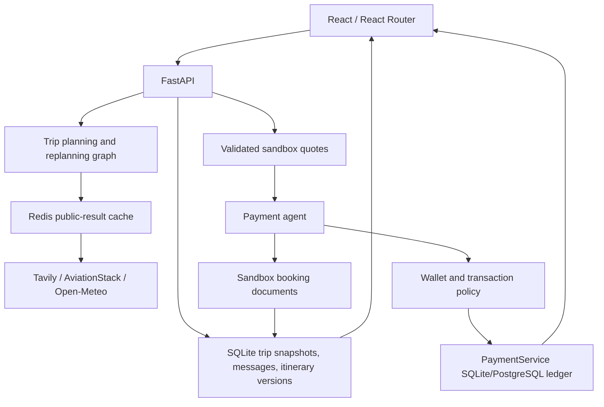

# System architecture

## Overview

TripMate keeps planning and payment orchestration in Python, FastAPI, and LangGraph. React with Vite and React Router handles trip creation, discovery, saved-trip navigation, itinerary editing, and sandbox booking interaction. The backend owns trip state, agent execution, validated quotes, durable storage, and payment status.

The SQLite trip store persists trip snapshots, request context, itinerary versions, and planner/edit messages. `TRIPMATE_TRIPS_DB` selects its path; the default is the user's TripMateAI application-data directory. The payment service keeps its own SQLite/PostgreSQL ledger and wallet. Trip records keep booking and payment references for display, but payment status is re-read from the ledger. Redis stores reusable public lookup responses only and falls back to bounded process-local caching when unavailable.

The traveler selects a hotel or local cab. The backend validates the server quote and runs the payment agent against the sandbox wallet and transaction policies. Successful sandbox bookings update the durable trip and itinerary. No real funds are transferred and no supplier inventory is reserved. Flight search results are schedules only.

## Module graph

## Durable boundaries

- SQLite trip data survives browser refreshes and backend restarts; local storage contains only the last trip ID.
- Trip itinerary versions are created when saved itinerary content changes. Replanning checks the expected version to reject stale writes.
- Redis is optional and never the source of truth for trip, wallet, booking, or payment status.
- The project has no user authentication. Saved-trip endpoints are single-user/demo scoped and need ownership checks before multi-user deployment.
- The payment ledger and trip database are separate files with distinct responsibilities; no payment secrets are stored in trip snapshots.

## Constraints

- Search-derived property descriptions are recommendations, not guaranteed supplier inventory.
- Sandbox prices are stable test quotes and are not live market prices.
- Model output can select only among server-validated quote candidates; the backend determines charged amounts.
- Payment transitions and ledger writes are deterministic and idempotent.
- Supplier reservations, real payment capture, and flight ticket issuance require separate provider integrations.
