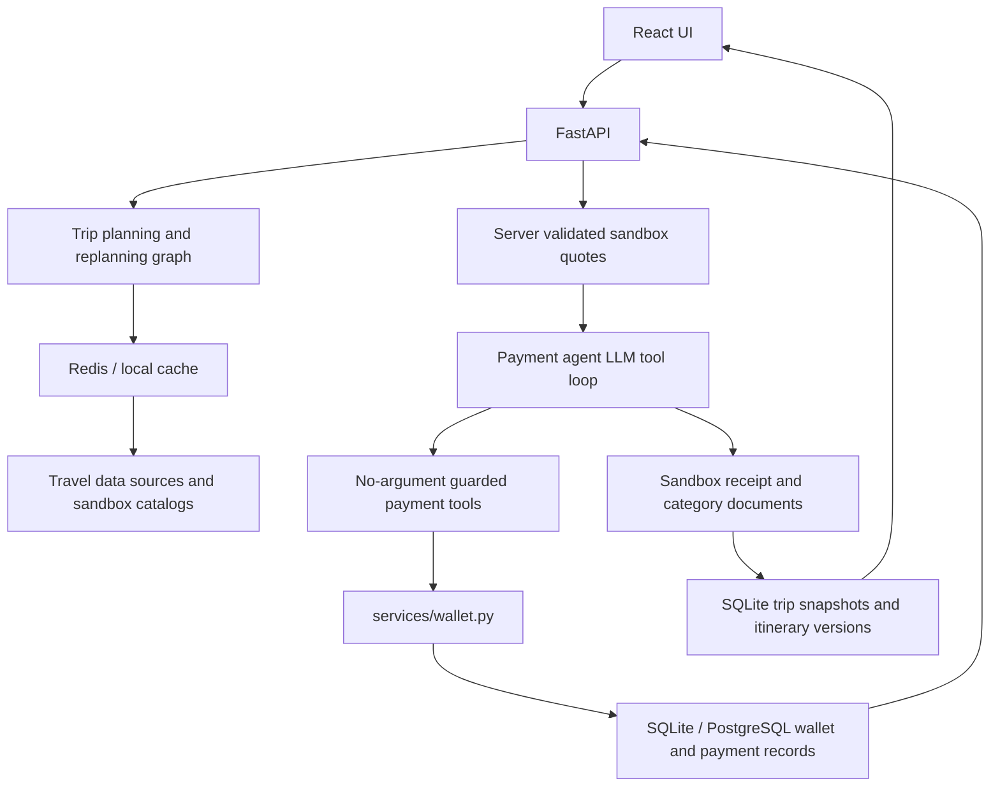

# System architecture

## Overview

TripMate combines a React and TypeScript interface with a FastAPI backend, LangGraph trip planning, an LLM-driven sandbox payment tool loop, a durable SQLite trip store, and a simulated Wallet service. The backend owns itinerary snapshots, validated quotes, payment policy, payment status, booking documents, and confirmed booking references.

Hotels and local cabs use server-generated sandbox quotes. Flight and train schedules use clearly labeled deterministic TripMate test prices tied to saved schedules; these are not live fares. All categories use the same checkout and simulated booking flow. No payment provider is contacted and no supplier inventory is reserved.

When model credentials are configured, `SimulatedPaymentAgent` asks an OpenAI-compatible LLM to choose one no-argument payment tool per turn. Python validates tool names, rejects arguments, caps turns, and records results. `services/wallet.py` owns every balance and payment mutation and rechecks rules when reserving and capturing. Booking confirmation must precede capture. If no model key is configured, the guarded tools use an offline safe sequence. The browser only displays backend-confirmed outcomes; newly confirmed itinerary items receive a brief teal highlight.

## Module graph

## Durable boundaries

- Trip snapshots and itinerary versions live in TripStore; wallet balance, payment status, and immutable movements live in the Wallet database.
- A quote is reconstructed and checked by the backend, including expiry and saved schedule membership, before funds are reserved.
- Idempotent payment and booking records prevent repeated clicks from charging twice.
- Schedule ticket documents are labeled simulated and are not valid supplier tickets. Real settlement and supplier reservations need separate provider integrations.
- The project has no user authentication. Saved-trip routes remain single-user/demo scoped until ownership checks are added.
