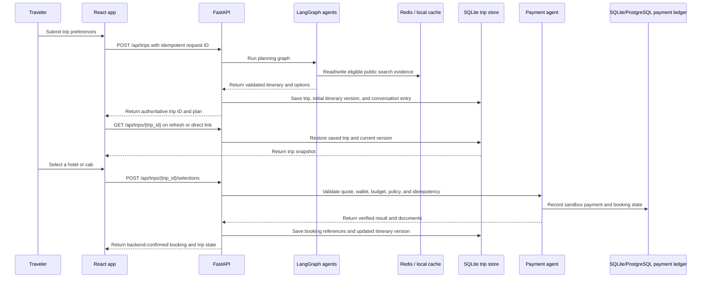

# Key flows

## Plan, save, restore, and book

## Replanning

The API loads the current trip snapshot from SQLite, checks the caller's expected itinerary version, and passes the stored itinerary and request context to the replanning agent. A stale version is rejected rather than overwriting a newer plan. Successful changes are saved as a new version with the user request and assistant summary. The last successful plan remains intact if the workflow fails. Confirmed sandbox booking entries are preserved during itinerary-only edits.

## Cache and payment authority

Redis caches eligible public provider research using normalized input keys and TTLs. Cache failure falls back to bounded in-process memory. Trip snapshots and versions are durable in SQLite. Wallet and payment status come from the payment ledger; frontend storage and Redis are never authoritative for money movement.

## Boundaries

Sandbox rates and booking documents exercise agent selection, policy checks, ledger state, idempotency, and itinerary updates. They do not transfer real funds or reserve supplier inventory. Flight data is schedule/status research rather than a purchasable ticket. The app has no user authentication yet, so durable trip routes must receive ownership controls before multi-user deployment.
