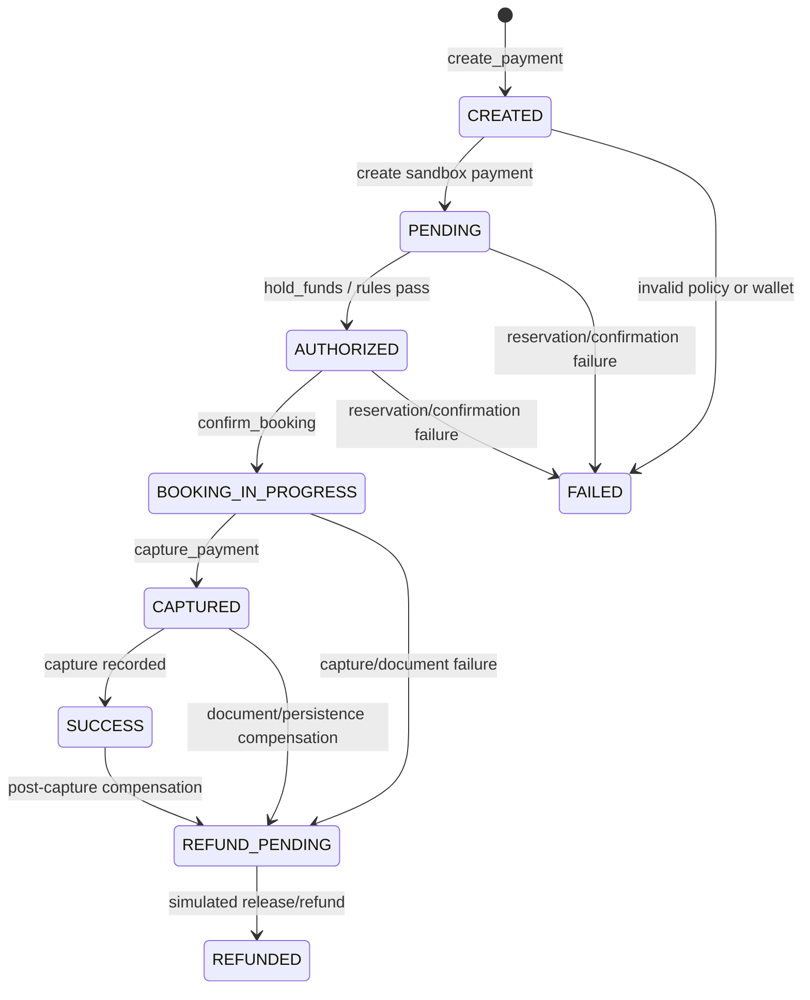

# TripMate payment and booking flow

This diagram describes TripMate's sandbox checkout. Payment is simulated in INR. A successful response records a demo booking; it does not reserve supplier inventory or make a real payment.

## End-to-end request flow

```mermaid
flowchart TD
  U[Traveler selects a hotel, cab, flight schedule, or train schedule]
  UI[React opens sandbox checkout window<br/>shows processing state]
  API[POST /api/trips/{trip_id}/selections]
  ID{Trip id and service type valid?}
  Q{Source-specific quote valid?<br/>Saved schedule match for flight/train}
  HOTEL[Hotel path<br/>AutonomousTripBookingAgent validates selected hotel quote]
  OTHER[Cab: regenerate local inventory quote<br/>Flight/train: match saved schedule and regenerate test quote]
  ITEM[Build trusted payment item<br/>INR amount in paise + idempotency key]
  AGENT[SimulatedPaymentAgent<br/>LLM chooses one no-argument tool per turn]
  TOOL{Tool name and arguments valid?}
  DETAILS[get_order_details + check_risk<br/>read-only checks]
  WALLET[Wallet service<br/>create payment + reserve simulated balance]
  CONFIRM[confirm_booking<br/>save simulated booking as confirmed]
  CAPTURE[capture_payment<br/>Wallet rechecks rules and captures once]
  DOCS[Build sandbox receipt and booking documents]
  SAVE[FastAPI saves booking reference and itinerary item in TripStore]
  OK[Return confirmed booking, payment, documents, and trip]
  UIOK[Checkout shows confirmation<br/>Return button closes the window]
  FAIL[Failure before payment<br/>invalid request, quote, or create/policy error]
  COMP[compensate<br/>fail payment or release/refund reserved funds]
  BAD[Return failure without success documents]
  U --> UI --> API --> ID
  ID -- no --> FAIL --> BAD
  ID -- yes --> Q
  Q -- no --> FAIL
  Q -- yes, hotel --> HOTEL --> ITEM
  Q -- yes, cab/flight/train --> OTHER --> ITEM
  ITEM --> AGENT --> TOOL
  TOOL -- invalid --> COMP --> BAD
  TOOL -- details or risk --> DETAILS --> AGENT
  TOOL -- hold_funds --> WALLET --> AGENT
  TOOL -- confirm_booking --> CONFIRM --> AGENT
  TOOL -- capture_payment --> CAPTURE
  CAPTURE -- decline/error --> COMP --> BAD
  CAPTURE -- paid --> DOCS --> SAVE --> OK --> UIOK
  AGENT -- stop or turn limit --> COMP --> BAD
  BAD --> UI
```

## Payment and booking states



`mark_booking_confirmed` changes the separate booking record to `CONFIRMED` while the payment remains `BOOKING_IN_PROGRESS`. Document issuance is stored on that booking record; it is not a separate payment status.

## How the agent loop works

When `GEMINI_API_KEY` or compatible model settings are configured, `SimulatedPaymentAgent` asks the model to choose one tool at a time. Each tool has no arguments, so the model cannot set a price, buyer, or balance. Python validates the tool name, rejects arguments, enforces a turn limit, and records the trace. `Wallet` is the only module that changes simulated balances or payment states. It repeats policy checks when reserving and capturing. The booking must be confirmed before capture. Tool results return to the model for its next choice. If model configuration is missing, the same guarded tools run in a safe offline sequence so sandbox checkout remains usable.

If a post-capture document or trip-save step fails, the agent attempts a wallet refund/compensation before returning a failure. The booking UI shows success only when it receives a confirmed backend booking record.

## Important boundaries

- Hotel and cab quotes use TripMate sandbox inventory. Flight and train schedule prices are simulated test prices, not supplier fares.
- All balances, ledger movements, captures, and refunds are simulated.
- Flight/train ticket documents and hotel/cab vouchers are demo records; no external reservation is issued.
- The browser opens the checkout window synchronously from the click. Closing it does not cancel backend work. Confirmed status can be re-read from the payment ledger.
- The React itinerary applies a brief teal highlight to newly confirmed booking items and replanned activities.
